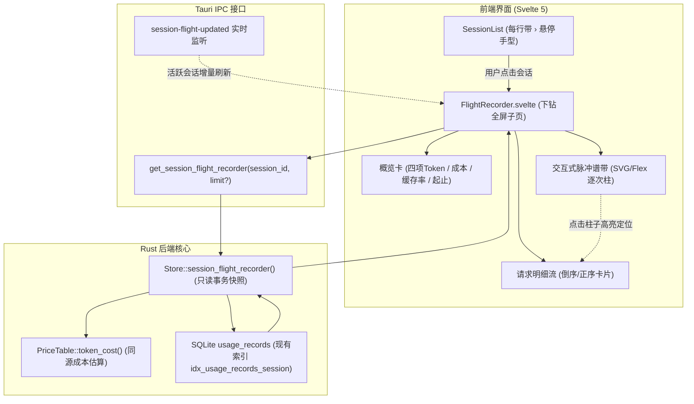

# v0.3 Flight Recorder 会话时间线洞察（Session Flight Recorder）设计规约

> 状态：定案（经 Codex & agy 双模型第二意见深度审查与工程加固）  
> 日期：2026-10-20  
> 目标版本：v0.3.0  
> 前置标准：token-watcher-design-v1.1.md（路线图第 6 位）、Meter Face 诚实工控美学、WCAG AA 4.5:1 对比度

---

## 1. 为什么需要 Flight Recorder（会话飞行记录仪）

在 Token Watcher v0.1 与 v0.2 中，主看板底部的「会话」区块只展示聚合结果：
`● token-watcher              128.5k`

### 1.1 开发者痛点与黑盒困境
- **消耗突刺归因难**：一个耗费 120k Token 的会话，开发者无法知道究竟是哪一次请求读取了大量未缓存内容、生成了冗长代码，还是因为子链（Sidechain）密集调用；
- **缓存命中感知盲区**：无法查看会话内 Cache Read 的持续复用曲线（例如首次加载写入 Cache Creation 后的缓存命中红利在何时被破坏失效）；
- **模型与中转混用不透明**：长会话中间何时切了 Sonnet / Haiku / Opus，或何时因切换代理配置而跳转了订阅档案，目前全被折叠在一条静态总数中。

### 1.2 预期行为对比
| 维度 | 现状（v0.2） | 期望（v0.3 Flight Recorder） |
|---|---|---|
| **会话列表交互** | 点击无反应，只读显示总数与活跃绿点 | 鼠标移入变手型悬停高亮，点击平滑下钻至「会话飞行记录仪」子页 |
| **会话时间维度** | 仅保留 `last_active_ms` 相对判断活跃度 | 精确展示起止时刻（如 `14:20:05 ~ 15:44:12`）与总交互时长（`1h 24m`） |
| **请求粒度透视** | 无法查看单次交互细节 | 逐次呈现（Req #1..N）：耗时、模型、四维 Token、估算单次金额 |
| **吞吐走势可视化** | 仅看板全局脉冲折线（5 分钟桶） | 交互式时间脉冲谱带：逐次 Token 柱、实算 vs 缓存区分、点击柱子跳转卡片 |
| **模型与档案漂移** | 无法观测多模型或多中转混合 | 清晰标识会话内模型切换点（Model Switch）与归因档案切换点 |

---

## 2. 双模型第二意见工程加固项（P0 ~ P2）

经由 Codex 与 agy 联合深度对抗性审查，针对原草案的 3 项 P0、5 项 P1 与若干工程细节作出统一裁决与加固：

### 2.1 P0 加固裁决
1. **类型契约完整性与既有基础设施复用（P0-1）**：
   - 严禁平行发明第二套数据结构；
   - 彻底复用 `TokenTotals`（`agg.rs`）与 `TokenCost`（`pricing.rs`）；
   - 补齐 `SessionModelSlice` 与 `SessionProfileSlice` 明确定义，并在 `profiles_used` 中单次下发 `display_name`，事件流仅保留 `profile_id`，杜绝数千条事件重复携带字符串。
2. **“Turn” 语义纠偏与 Sidechain（子链）隔离（P0-2）**：
   - 纠偏：底层一条记录 `record_id` 对应一次 API 往返（`message.id`），不是人类交互轮次（一个 Agentic 轮次内可包含多轮 API 调用）。契约字段统一命名为 `request_index` / `total_requests`；
   - 子链隔离：`is_sidechain = true` 的子链记录在脉冲谱和事件流中通过徽标与灰化清晰区分；
   - 跃迁检测：`model_switched` 与 `profile_switched` 仅相对前一条**同链属性（主链相对前一条主链）**的事件进行判定，彻底消除主子链模型交替时产生的虚假切换风暴。
3. **LIVE 实时刷新机制与事件契约闭环（P0-3）**：
   - 现有 `usage-pulse` 无 `session_id` 且 `dashboard-dirty` 为全局无参信号；
   - 在 `watch.rs` Ingestion 管道提交事务后，定向发出 `session-flight-updated` 事件（携带更新的 `session_id` 集合）；
   - 前端当前视图若正处在该 `session_id` 的 Flight Recorder，防抖触发只读增量/刷新；
   - `is_active` 判定严格复用 `agg.rs:26` 的 `ACTIVE_WINDOW_MS`（5 分钟同源口径）。

### 2.2 P1 加固裁决
4. **有界 Payload 与双层数据加载（P1-1）**：
   - 会话概览卡（totals、models_used、profiles_used）与脉冲谱带数据（极轻量元组 `(index, timestamp_ms, total, cache_read, is_sidechain)`）由 SQL 聚合全量精准返回；
   - 详细事件流 `events` 实行有界加载（默认返回最新 200 条，支持 `events_truncated: bool` 与按时间向下滚动分页），阻断 3,000 条长会话造成的 1.5MB IPC 序列化与 DOM 阻塞。
5. **口径独立性明确（P1-2）**：
   - 主看板会话列表受顶部时间筛选（today/week/month）限制；
   - **Flight Recorder 严格定义为「会话全生命周期」真实还原**，不受主看板 range 筛选切断，并在概览卡明确标注完整起止日期与时长。
6. **突刺（Spike）科学诚实判定（P1-3）**：
   - 坚决删除编造的“大文件读入”猜测性标签，遵循项目 D20 诚实原则；
   - 采用纯数据驱动的双门限判定：`total_tokens >= 10,000` 且 `total_tokens >= 2.5 * session_mean_tokens`；
   - 突刺原因以客观事实标注：
     - `未缓存输入主导` (`input_tokens` 占比最高且无缓存命中)；
     - `缓存重建/写入` (`cache_creation_tokens` 激增)；
     - `长文本生成` (`output_tokens` 激增)；
     - `缓存命中复用` (`cache_read_tokens` 主导)。
7. **快照一致性与只读事务（P1-4）**：
   - 后端查询概览与明细包裹在同一个 SQLite 读事务（`BEGIN DEFERRED ... COMMIT`）中，确保 totals 与 events 绝对处于同一时间切片，杜绝 LIVE 并发写入导致的总数对不上。
8. **IPC 惯例对齐（P1-5）**：
   - 命令对齐现有 `get_dashboard` 模式：同步接受 `State<'_, AppState>`，复用内部只读连接 `open_readonly` 与共享价格表引用，确保与看板成本计算 100% 同源。

### 2.3 P2 性能与显示规范
9. **缓存命中率命名与分母**：
   - 明确命名为 `cache_hit_ratio`，公式为 `cache_read / (input + cache_read)`（输入侧缓存命中率，当分母为 0 时安全归零）；
   - 概览卡四项 Token 明确分开展示：`In`, `Out`, `Cache Read`, `Cache Write`。
10. **紧凑窗口自适应布局**：
    - 脉冲谱带在 340px 容器内，柱子数量过多（>80）时支持水平横滚与悬停高亮；
    - 单轮未定价模型诚实显示 `$—*`，绝不标为 `$0.00`。

---

## 3. 核心架构与数据流



---

## 4. 详细数据契约定义

### 4.1 Rust 数据结构（`src-tauri/src/core/agg.rs`）

```rust
use super::pricing::TokenCost;
use super::store::Totals;

/// 脉冲谱带极简点（用于顶部可视化，全量下发，体积仅几个字节）
#[derive(Debug, Clone, Copy, PartialEq, Eq, Serialize, Deserialize)]
pub struct PulsePoint {
    pub index: usize,
    pub timestamp_ms: i64,
    pub total_tokens: i64,
    pub cache_read_tokens: i64,
    pub is_sidechain: bool,
    pub is_spike: bool,
}

/// 单次请求事件明细
#[derive(Debug, Clone, PartialEq, Serialize, Deserialize)]
pub struct FlightRecordEvent {
    pub request_index: usize,
    pub record_id: String,
    pub timestamp_ms: i64,
    pub input_tokens: i64,
    pub output_tokens: i64,
    pub cache_read_tokens: i64,
    pub cache_creation_tokens: i64,
    pub total_tokens: i64,
    pub model: String,
    pub entrypoint: String,
    pub is_sidechain: bool,
    pub profile_id: Option<i64>,
    pub attribution_source: String,
    pub cost: TokenCost,
    pub model_switched: bool,
    pub profile_switched: bool,
    pub is_spike: bool,
    pub spike_reason: Option<String>,
}

#[derive(Debug, Clone, PartialEq, Serialize, Deserialize)]
pub struct SessionModelSlice {
    pub model: String,
    pub tokens: Totals,
    pub cost: TokenCost,
    pub share: f64,
}

#[derive(Debug, Clone, PartialEq, Serialize, Deserialize)]
pub struct SessionProfileSlice {
    pub profile_id: Option<i64>,
    pub display_name: String,
    pub tokens: Totals,
    pub cost: TokenCost,
}

/// 会话飞行记录仪完整视图响应
#[derive(Debug, Clone, PartialEq, Serialize, Deserialize)]
pub struct SessionFlightRecorder {
    pub session_id: String,
    pub title: String,
    pub cwd: Option<String>,
    pub cc_version: Option<String>,
    pub start_time_ms: i64,
    pub end_time_ms: i64,
    pub duration_seconds: i64,
    pub is_active: bool,
    pub total_requests: usize,
    pub totals: Totals,
    pub cost: TokenCost,
    pub cache_hit_ratio: f64,
    pub models_used: Vec<SessionModelSlice>,
    pub profiles_used: Vec<SessionProfileSlice>,
    pub pulse_strip: Vec<PulsePoint>,
    pub events: Vec<FlightRecordEvent>,
    pub events_truncated: bool,
}
```

### 4.2 TypeScript 类型契约（`ui/src/data/types.ts`）

```typescript
export interface PulsePoint {
  index: number;
  timestamp_ms: number;
  total_tokens: number;
  cache_read_tokens: number;
  is_sidechain: boolean;
  is_spike: boolean;
}

export interface FlightRecordEvent {
  request_index: number;
  record_id: string;
  timestamp_ms: number;
  input_tokens: number;
  output_tokens: number;
  cache_read_tokens: number;
  cache_creation_tokens: number;
  total_tokens: number;
  model: string;
  entrypoint: string;
  is_sidechain: boolean;
  profile_id: number | null;
  attribution_source: string;
  cost: TokenCost;
  model_switched: bool;
  profile_switched: bool;
  is_spike: bool;
  spike_reason: string | null;
}

export interface SessionModelSlice {
  model: string;
  tokens: TokenTotals;
  cost: TokenCost;
  share: number;
}

export interface SessionProfileSlice {
  profile_id: number | null;
  display_name: string;
  tokens: TokenTotals;
  cost: TokenCost;
}

export interface SessionFlightRecorder {
  session_id: string;
  title: string;
  cwd: string | null;
  cc_version: string | null;
  start_time_ms: number;
  end_time_ms: number;
  duration_seconds: number;
  is_active: boolean;
  total_requests: number;
  totals: TokenTotals;
  cost: TokenCost;
  cache_hit_ratio: number;
  models_used: SessionModelSlice[];
  profiles_used: SessionProfileSlice[];
  pulse_strip: PulsePoint[];
  events: FlightRecordEvent[];
  events_truncated: boolean;
}
```

---

## 5. 验收标准与验证方案

1. **测试矩阵（`tests/t15_flight_recorder.rs`）**：
   - 空库/不存在会话查询返回 `None`；
   - 单请求会话正常计算（起止时间相同，`duration_seconds = 0`，不除零崩溃）；
   - 多请求正常会话：测试 Totals、TokenCost、模型分布与占比、缓存命中率的准确性；
   - 主链与子链（sidechain）隔离：`model_switched` 正确跳过子链，不产生虚假切换；
   - 突刺（Spike）判定：正确标记超过阈值的突刺请求，并输出对应客观原因；
   - 读快照一致性：验证事务内查询与并发写入的隔离。
2. **Clippy 门禁**：`cargo clippy --all-targets -- -D warnings` 零警告。
3. **前端构建与渲染**：`npm run build` 顺利通过，在 380px 悬浮窗中完整响应下钻、脉冲条交互、返回导航与 LIVE 活跃联动。
