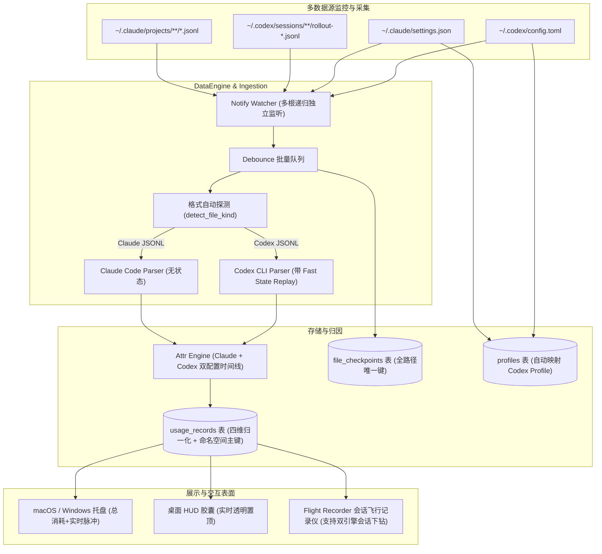

# v0.3 多数据源扩展（Multi-Engine Ingestion）设计规约

> 状态：定案（经 Codex & agy 双模型第二意见深度对抗审查与工程加固）  
> 日期：2026-10-20  
> 目标版本：v0.3.0  
> 前置标准：token-watcher-design-v1.1.md（路线图第 7 位）、docs/data-source/claude-code-jsonl.md、docs/designs/v0.3-flight-recorder-spec.md

---

## 1. 为什么需要多数据源扩展

### 1.1 背景与用户痛点
在 Token Watcher v0.1 与 v0.2 中，数据源仅硬编码支持 Claude Code（`~/.claude/projects/**/*.jsonl` 与 `~/.claude/settings.json`）。
随着开发流演进，VibeCoding 开发者往往同时使用多款 AI 编程 CLI 工具（如 Claude Code 与 OpenAI Codex CLI）。
目前开发者在使用 Codex CLI 时，所有 Token 消耗处于完全观测盲区：
- 无法在菜单栏与 HUD 胶囊中看到实时的 Token 脉冲；
- 无法统计 Codex 模型（如 `gpt-6.1-sol`、`gemini-4-argon` 等）的四维 Token 与消耗金额；
- 无法在 Flight Recorder（飞行记录仪）中下钻回放 Codex 会话的交互过程与突刺详情；
- 无法将通过 CC Switch 等本地代理切换中转的 Codex 会话归因到对应订阅档案。

### 1.2 预期行为对比
| 维度 | 现状（仅 Claude Code） | 期望（多数据源扩展） |
|---|---|---|
| **支持引擎** | 仅 `~/.claude` | 并行支持 Claude Code 与 Codex CLI（`~/.codex`） |
| **文件监控** | 仅监听 `~/.claude/projects` | 独立多根监控：并行监听 `~/.claude/projects` 与 `~/.codex/sessions` |
| **单引擎缺失容错** | 缺失 `projects_root` 则全部跳过 | 逐根独立判定：未装 Claude Code 照常监控 Codex，反之亦然 |
| **Token 口径** | 仅 Anthropic 纯净输入口径 | 统一归一化：OpenAI 包含式输入自动剥离缓存与写入，全局口径互斥对齐 |
| **程序维度 (entrypoint)** | `claude` / `claude-cli` | 增加 `codex-tui`、`codex_exec`（缺失兜底 `codex`） |
| **订阅归因** | 仅解析 `settings.json` | 增加解析 `~/.codex/config.toml`，自动匹配 Profile |
| **会话下钻** | 仅 Claude Code 会话进入飞行记录仪 | Codex 会话同源支持完整 Flight Recorder 时间线、脉冲谱带与模型切片 |

---

## 2. 双模型第二意见工程加固项（P0 ~ P2 全部裁决收敛）

经由 Codex（gpt-6.1-sol）与 agy（Gemini）联合深度对抗性审查，针对原草案的 1 项 P0、5 项 P1 与若干工程细节作出统一裁决与加固：

### 2.1 P0 加固裁决
1. **废弃脆弱的「DB 历史回填 + 4KB 头回填」，改为极速向前重放状态（Fast State Replay）（P0-1）**：
   - **漏洞实证**：Codex `session_meta` 单行高达 22KB（内嵌完整 instructions），前 4KB 必定切在半行导致 JSON 解析失败；且 500ms debounce flush 在首轮 API 响应前就会把 checkpoint 推过 `turn_context`，导致首轮增量读取时 DB 查无记录、4KB 读不到，整轮所有用量记录永久以 `model=""` 落库！
   - **加固裁决**：当增量摄入 `byte_offset > 0` 且解析器缺少当前模型状态时，**从 byte 0 极速向前重放状态**：
     - 只需流式扫描至 `offset`，遇到 `session_meta`、`turn_context`、`event_msg/thread_settings_applied` 时更新元数据状态，其余内容全部跳过；
     - 文件大小中位数仅 134KB，状态重放仅需毫秒级（比盲目 DB 查询更可靠）；
     - 彻底消除换模型时的陈旧模型（Stale Model）隐患与会话首轮空模型脏数据。

### 2.2 P1 加固裁决
2. **严防缓存写入双计与四维互斥归一化（P1-1）**：
   - **漏洞实证**：OpenAI 规范中 `input_tokens` 包含未命中、命中缓存以及本次新写入缓存的全部 prompt token；若只减 `cached_input_tokens`，会导致 `cache_write_input_tokens` 既留在 input 里又被单列入 cache_creation，造成重复计费！
   - **加固裁决**：
     $$\text{net\_input} = \text{raw.input\_tokens} - \text{raw.cached\_input\_tokens} - \text{raw.cache\_write\_input\_tokens}$$
     $$\text{cache\_read} = \text{raw.cached\_input\_tokens}$$
     $$\text{cache\_creation} = \text{raw.cache\_write\_input\_tokens}$$
     $$\text{output} = \text{raw.output\_tokens}$$
     若 $\text{net\_input} < 0$ 或四项之和不等于 $\text{raw.total\_tokens}$，判定为非法破损行（Bad line）进行告警计数，坚决不进行静默钳零（Silent Clamp），防止非标准中转代理的口径漂移掩盖问题。
3. **命名空间主键阻断 Resume 会话历史改写（P1-2）**：
   - **漏洞实证**：若直接用 `record_id = response_id`，在 Codex CLI resume 会话场景下如果新 rollout 文件回放了旧 response，后扫的文件通过 `ON CONFLICT DO UPDATE SET session_id = excluded.session_id` 会把历史记录搬家到新 session，破坏历史数据完整性。
   - **加固裁决**：主键加入引擎命名空间与会话隔离：
     $$\text{record\_id} = \text{"codex:"} + \text{session\_id} + \text{":"} + \text{response\_id}$$
     若 `response_id` 缺失，防御性回退键为 `format!("codex:{session_id}:{turn_id}:{ordinal}")`（利用行级单调递增的 `ordinal`，杜绝毫秒时间戳碰撞）。
4. **修正 `thread_settings_applied` 嵌套路径（P1-3）**：
   - **漏洞实证**：在 `event_msg` 中，模型字段嵌套在 `payload.thread_settings.model`，而非顶层 `payload.model`。
   - **加固裁决**：解析器准确取值 `payload.get("thread_settings").and_then(|ts| ts.get("model"))`。
5. **多数据源逐根独立首扫与动态探测（P1-4）**：
   - **漏洞实证**：原 `initial_scan` 当 `~/.claude/projects` 不存在时直接提前 return，导致只装了 Codex 的用户被全部跳过。
   - **加固裁决**：将 `initial_scan` 改为对各引擎独立执行；若用户未安装 Claude Code 或未安装 Codex，仅跳过该引擎并不报致命错；在 `on_window_shown` 中定期重试未发现的根目录，保证事后安装无需重启。

### 2.3 P2 规范与防御
6. **锁定唯一用量来源（P2-1）**：
   - 严禁从 `compacted`（内嵌历史快照）或 `event_msg/token_count` 提取用量；
   - 契约写死：Codex CLI 的唯一用量来源是 `type == "token_usage_record"`。
7. **明确 Reasoning Tokens 归属（P2-2）**：
   - OpenAI 的 `reasoning_output_tokens` 严格是 `output_tokens` 的子集，计价与聚合无需单列，直接包含在 `output_tokens` 中，与现有四维看板模型无缝兼容。

---

## 3. 核心架构与数据流



---

## 4. 契约设计与代码改动面

### 4.1 数据路径配置扩展（`DataPaths`）
`src-tauri/src/watch.rs`:
```rust
#[derive(Debug, Clone)]
pub struct DataPaths {
    pub claude_projects_root: PathBuf,
    pub claude_settings_path: PathBuf,
    pub claude_dir: PathBuf,
    pub codex_sessions_root: PathBuf,
    pub codex_config_path: PathBuf,
    pub codex_dir: PathBuf,
    pub db_path: PathBuf,
}
```
兼容保留 `projects_root` 和 `settings_path` 别名getter，确保老测试无缝通过。

### 4.2 文件格式自动探测（`FileEngineKind`）
`src-tauri/src/core/ingest.rs`:
```rust
#[derive(Debug, Clone, Copy, PartialEq, Eq)]
pub enum FileEngineKind {
    ClaudeCode,
    CodexCli,
    Unknown,
}

pub fn detect_file_kind(path: &Path, sample_bytes: &[u8]) -> FileEngineKind {
    let filename = path.file_name().and_then(|n| n.to_str()).unwrap_or_default();
    if filename.starts_with("rollout-") && filename.ends_with(".jsonl") {
        return FileEngineKind::CodexCli;
    }
    // 内容特征兜底
    if sample_bytes.windows(14).any(|w| w == b"\"session_meta\"")
        || sample_bytes.windows(20).any(|w| w == b"\"token_usage_record\"")
    {
        return FileEngineKind::CodexCli;
    }
    FileEngineKind::ClaudeCode
}
```

### 4.3 Codex 状态机与解析器（`parse_codex`）
`src-tauri/src/core/parse.rs`:
```rust
#[derive(Debug, Clone, Default)]
pub struct CodexFileState {
    pub session_id: Option<String>,
    pub current_model: Option<String>,
    pub cwd: Option<String>,
    pub cli_version: Option<String>,
    pub originator: Option<String>,
}

pub fn parse_codex_line(line: &[u8], state: &mut CodexFileState) -> ParsedLine;
```
1. **`session_meta`**：提取 `session_id`, `cwd`, `cli_version`, `originator`，返回 `Ignored`；
2. **`turn_context`**：提取 `model`, `cwd`，返回 `Ignored`；
3. **`event_msg` / `thread_settings_applied`**：提取 `payload.thread_settings.model`，返回 `Ignored`；
4. **`token_usage_record`**：
   - 提取 `record_id = format!("codex:{}:{}", session_id, response_id)`；
   - 提取四维 Token 并执行互斥归一化与 `total_tokens` 对账；
   - 构造并返回 `ParsedLine::Record(UsageRecord)`；
5. **其它类型**（含 `compacted`、`token_count` 等）：一律返回 `Ignored`。

### 4.4 极速状态重放机制（Fast State Replay）
在 `ingest_file_with_records` 中：
- 若探测为 `FileEngineKind::CodexCli` 且 `offset > 0`：
  - 打开文件流，从 0 扫描至 `offset`；
  - 仅识别 `session_meta`、`turn_context`、`thread_settings_applied` 更新 `CodexFileState`；
  - 从 `offset` 开始正常增量解析追加记录。

### 4.5 Codex Profile 自动关联
在 `attr.rs` 中：
- 解析 `~/.codex/config.toml`；
- 提取 `model_providers.custom.base_url`（如存在，构建 Profile；缺失则映射为 `https://api.openai.com/v1`）；
- 在 `upsert_records` 阶段，Codex 记录若未被 proxy 归因，自动归因至该 Profile。

---

## 5. 测试与验收指标

1. **单元测试矩阵（`tests/` & 内联测试）**：
   - Codex 各类型行解析覆盖率 100%；
   - Token 归一化算法（含 cache_write 扣减、坏行对账判定）；
   - Fast State Replay 状态重放测试（含中途切模型切换点还原）；
   - `config.toml` Profile 自动建立与归因；
2. **集成与真实数据回放压测**：
   - 逐 flush 模拟增量压测：对真实 Codex session 模拟分段写入与断点续读，确保 0 坏行、0 脏模型；
   - 既有 112 项测试全部绿色通过；
   - `cargo clippy --all-targets -- -D warnings` 零告警。
